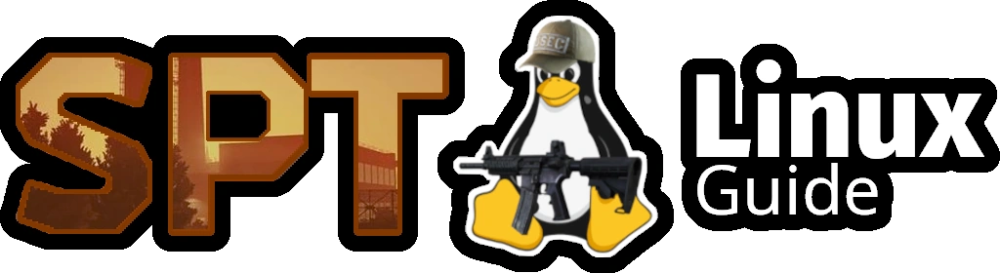

</img>

Here you can find everything you need to install & play SPT on Linux.

> [!WARNING]
> ## MAINTENANCE MODE
> This guide is currently in maintenance mode. This means we will only be fixing bugs and making minor improvements.

# How to install 💿

## Dependencies

- [ASP.NET Desktop Runtime 10.0](https://dotnet.microsoft.com/en-us/download/dotnet/10.0)
    - Install the `aspnetcore-runtime-10.0` system package ([how to install](docs/aspnet.md))

- [UMU-Launcher](https://github.com/Open-Wine-Components/umu-launcher)
    - Some distros provide a `umu-launcher` system package
    - Alternatively, [download the latest Release](https://github.com/Open-Wine-Components/umu-launcher/releases) from Github

- [SPTInstaller](https://github.com/SP-Tushonka/installer)
    - [Download the latest Linux installer](https://github.com/SP-Tushonka/installer/releases) from Github

## Install

1. Install dependencies listed above 🔝
2. Install the Live game client (Steam or the official launcher) 🎮
3. Run the SPTInstaller & follow the instructions inside the app ☝️

Steam installs are detected automatically. If you own the official launcher version, you have to manually select the path to the game files inside the installer.

Application menu shortcuts will be created automatically.

### Get your favorite mods from **THE FORGE** 📢
- https://sp-mod.com/

### If you encounter any issues, feel free to visit us on [Discord](https://discord.com/invite/Xn9msqQZan)! 🗨️

    Community-Support/SPT on Linux - User Discussion Thread

# Contributions 🚧
If you want to contribute to the guide, feel free to:
- Send us a [pull request](https://github.com/MadByteDE/SPT-Linux-Guide/compare/SPTv4-Dev...main)
- Open a [new issue](https://github.com/MadByteDE/SPT-Linux-Guide/issues/new/choose)
- Contact us on [Discord](https://discord.com/invite/Xn9msqQZan)

If you want to send us a PR, please make sure the formatting of your addition matches the existing content in our guide.

# Credits ♥️

Thanks to everyone helping out and contributing to the guide!

## Guide contributors
- **APoorDev**
- **dj3hac**
- **Laserpulse**
- **LinuxFromMars**
- **nyuware**
- **Penkov**
- **TheSpectator**
- **Witek**

